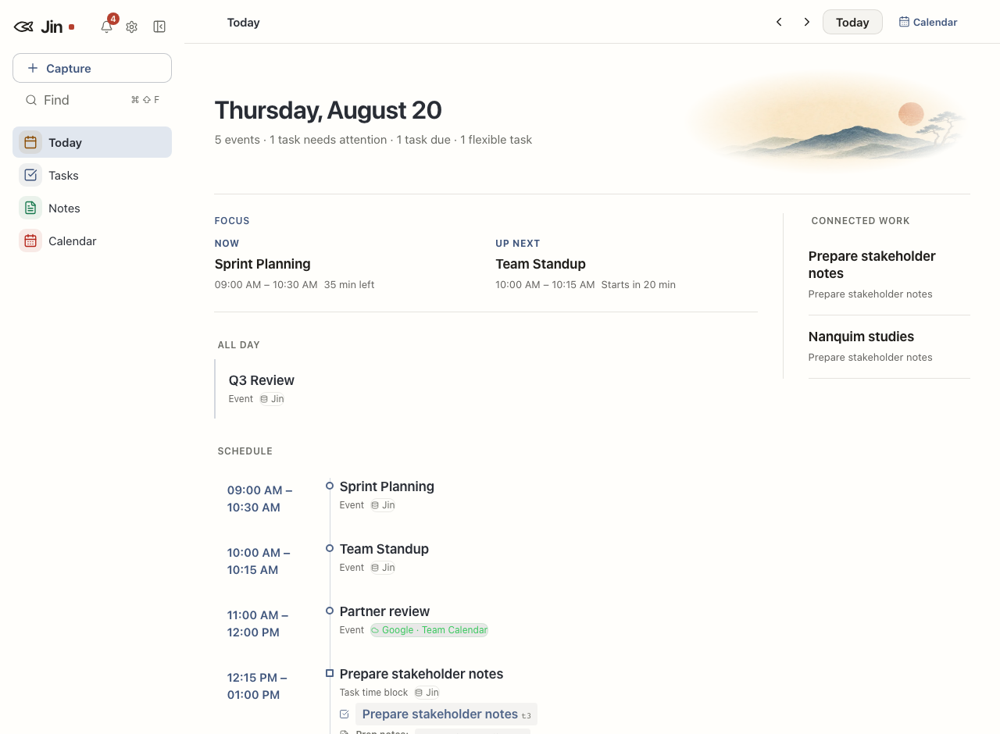

<div align="center">


# Jin

**Your notes, tasks, and calendar in one local workspace.**

[](https://github.com/Rynaro/jin/actions/workflows/ci.yml)
[](https://github.com/Rynaro/jin/releases/latest)
[](LICENSE)

[Download](#download) · [Get started](#get-started) · [Features](#features) · [Build from source](#build-from-source) · [Contribute](CONTRIBUTING.md)

</div>



<p align="center"><sub>Today view with example data. Your workspace starts with your own files.</sub></p>

Jin brings daily planning and the work behind it into one place. Write notes,
track tasks, and see calendar context without handing over your data: Markdown
and YAML are the source of truth, while SQLite is a rebuildable index. The
desktop app and command-line interface use the same Rust core.

## Features

- **A connected day.** See events, tasks, and related notes together in Today.
- **Notes that stay yours.** Write and organize Markdown notes in a local
  folder, with links to the work and events they support.
- **Tasks with structure.** Capture tasks, organize them in lists or boards,
  and schedule one as an event when it needs time on the calendar.
- **A desktop app and a CLI.** Work visually or script common actions against
  the same local workspace.
- **Calendar when you want it.** Official desktop releases can connect Google
  Calendar from **Settings → Calendars & Sync → Connect Google Calendar**.
  Self-built and downstream packages can supply their own OAuth client. Desktop
  reminders run on your device while Jin is open. The [Google Calendar setup
  guide](docs/google-smoke-test.md) covers the publisher rollout, local pilot,
  and advanced credential overrides.

## Download

The [latest release](https://github.com/Rynaro/jin/releases/latest) has
desktop installers and CLI archives. These are the published v1.0.0 assets:

| Platform | Desktop app | CLI |
| --- | --- | --- |
| macOS · Apple Silicon | [DMG](https://github.com/Rynaro/jin/releases/download/v1.0.0/Jin_1.0.0_aarch64.dmg) | [tar.gz](https://github.com/Rynaro/jin/releases/download/v1.0.0/jin-cli-1.0.0-macos-aarch64.tar.gz) |
| Linux · x86-64 | [DEB](https://github.com/Rynaro/jin/releases/download/v1.0.0/Jin_1.0.0_amd64.deb) · [AppImage](https://github.com/Rynaro/jin/releases/download/v1.0.0/Jin_1.0.0_amd64.AppImage) | [tar.gz](https://github.com/Rynaro/jin/releases/download/v1.0.0/jin-cli-1.0.0-linux-x86_64.tar.gz) |
| Windows · x86-64 | [Setup EXE](https://github.com/Rynaro/jin/releases/download/v1.0.0/Jin_1.0.0_x64-setup.exe) | [ZIP](https://github.com/Rynaro/jin/releases/download/v1.0.0/jin-cli-1.0.0-windows-x86_64.zip) |

On macOS, open the DMG and drag Jin to Applications. On Linux, install the DEB
or make the AppImage executable and run it. On Windows, run the setup EXE.
For the CLI, extract the archive and put `jin` (or `jin.exe`) on your `PATH`.
Check a download against the release’s [SHA256SUMS](https://github.com/Rynaro/jin/releases/download/v1.0.0/SHA256SUMS).

The macOS app is ad-hoc signed but not Apple notarized; the Windows installer
is unsigned. Your OS may ask you to confirm that you want to open it. Linux
packages are built on Ubuntu 24.04 x64 and require a graphical desktop with
WebKitGTK support.

## Get started

**Desktop:** Open Jin and follow the first-run guide to choose a folder for
your workspace. Capture a note or task, then open Today to see what is ahead.

### Connect your notes, tasks, and calendar

- On a wide screen, keep the Notes library open beside the current document or
  choose **Hide note library** for a focused writing view. Choose **Show note
  library** to return to your notes.
- Open **Find in Jin** or press **⌘⇧F** on Mac or **Ctrl+Shift+F** on Windows
  and Linux to search notes, tasks, and calendar events.
- Use **Capture** to save a thought without leaving your current work. Capture
  a note for later review, or save a task directly to Inbox. In **Review
  captures**, keep a note as reference, make a linked task, attach it to an
  exact calendar event, or choose a day for it to return.
- In a calendar event, choose **New meeting note** to create an editable
  preparation note linked to that event.
- Select text in a note and choose **Create task from selection**. Review the
  task title and selected text, then choose **Create task** to keep writing or
  **Create and open task** to continue from the task.
- Choose **Schedule time** on a task or a task in the calendar day view to
  review its start time, duration, timezone, and calendar before saving. If the
  task already has a time block, Jin offers to open it.

**CLI:** Initialize a folder, add some work, and view your agenda:

```console
$ jin --root ~/jin-store init
$ jin --root ~/jin-store note add "Roadmap review notes"
$ jin --root ~/jin-store task add "Draft quarterly roadmap"
$ jin --root ~/jin-store today
$ jin --root ~/jin-store review list
```

Run `jin --help` to explore commands and `jin <command> --help` for options.
The CLI also supports JSON output for scripts.

### Use a sync folder safely

For a folder managed by Google Drive, ownCloud or Nextcloud, OneDrive, iCloud,
or another file synchronizer, create a dedicated portable workspace:

```console
$ jin --root ~/Jin-Sync init --portable
```

Keep that folder available offline on every device and keep Jin up to date on
each device. Sync the complete workspace, including the hidden `.jin` marker
and attachments. Each device rebuilds its own index and keeps its own local
history, Google settings, and credentials.

When another device's changes arrive, refresh before continuing:

```console
$ jin --root ~/Jin-Sync refresh
```

Jin reports malformed files and conflicting copies before choosing an index
entry. Keep every reported variant, including the original Markdown. Copy a
variant outside the canonical folders while you reconcile it, then run
`refresh` again. Do not delete a copy until you have confirmed which content is
safe to retain. `jin --root ~/Jin-Sync history note <id>` lists the immutable
local versions Jin has observed. A provider overwrite that Jin never observed
cannot be recovered by Jin.

For a verified backup or migration, export to a new empty folder and import
only after verification:

```console
$ jin --root ~/Jin-Local export ~/Jin-Backup
$ jin import ~/Jin-Backup ~/Jin-Restored
```

Exports include notes, tasks, events, lists, tags, collections, and attachments.
Local recovery history stays on the device and both it and separate backups use
device disk space. To move an existing legacy workspace into portable mode,
export it first, initialize a fresh empty folder, and force-import only into
that newly initialized empty portable root:

```console
$ jin --root ~/Jin-Local export ~/Jin-Backup
$ jin --root ~/Jin-Sync init --portable
$ jin import ~/Jin-Backup ~/Jin-Sync --force
```

Before a large restore or migration, close Jin on other devices and pause the
folder synchronizer. File replacements are atomic, but a multi-directory
restore is not externally atomic. Resume sync only after opening Jin and
confirming the restored contents.

## Your data and integrations

Your workspace’s Markdown and YAML files are canonical. Jin can rebuild its
SQLite index from them, and the CLI supports export and import. Optional Google
Calendar sync in an official desktop release starts with **Connect Google
Calendar** on first install; when building from source, configure your own
Google Desktop OAuth client. See the [setup guide](docs/google-smoke-test.md).
Reminders are local to the desktop app and do not sync between devices.

Portable workspaces use generic file synchronizers and do not require provider
APIs. Their reliability depends on the provider keeping the dedicated folder
available offline and preserving complete files. The desktop app's first-run
flow initializes this same portable layout when you choose a new empty storage
folder. The automated coverage validates the filesystem contract; it does not
validate real Google Drive, OneDrive, iCloud, or other provider accounts.

Jin is actively developed. Real-account OAuth validation, recurring-event
editing, and mobile capture remain work in progress.
Automated GUI checks cover logic; native appearance and installer behavior
need platform testing.

## AI-assisted development

Contributors can optionally use [Magicite project skills](docs/magicite.md)
with Claude Code or Codex. The guide covers the pinned client, protected setup,
offline model cache, and review of Jin’s authored engrams.

## Build from source

Install stable Rust and, for the desktop app, Node.js 24 LTS and npm 10+. macOS
needs Xcode Command Line Tools; Linux needs the
[Tauri prerequisites](https://v2.tauri.app/start/prerequisites/).

```bash
git clone https://github.com/Rynaro/jin.git
cd jin
cargo build --release --locked -p jin
./target/release/jin --root ~/jin-store init
```

For desktop development:

```bash
cd jin-gui
npm ci
npm run tauri -- dev
```

Run `make verify` for core and CLI checks, `make verify-gui` for GUI logic,
or `make verify-all` for both. The [release runbook](docs/releasing.md)
covers packaging.

## Documentation and help

| Topic | Where to go |
| --- | --- |
| First-run setup | [Getting started with the desktop app](docs/first-time-setup.md) |
| Calendar connection | [Google Calendar setup and smoke test](docs/google-smoke-test.md) |
| Architecture | [Architecture decisions](docs/adr/) |
| Testing | [Testing strategy](docs/testing.md) · [GUI testing](docs/gui-testing.md) |
| Questions or bugs | [GitHub Issues](https://github.com/Rynaro/jin/issues) |
| Security reports | [Security policy](SECURITY.md) |
| Contributions | [Contributing guide](CONTRIBUTING.md) |

Jin is licensed under the [GNU Affero General Public License v3.0](LICENSE).
